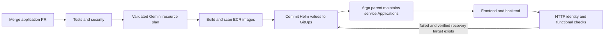

# Idea Board

A React frontend, FastAPI backend and PostgreSQL database. Application delivery uses ECR, Gemini planning and Argo CD.

## Which repository do I use?

| Repository | Owns |
| --- | --- |
| **om-idea-board** — this repo | Frontend/backend, tests, CI and AI/GitOps helpers |
| [infra-helm-charts](https://github.com/surendarrajasekaran/infra-helm-charts) | Helm charts, component values, parent/child Argo Applications, health workflow and rollback records |
| [terraform-infrastructure](https://github.com/surendarrajasekaran/terraform-infrastructure) — private | Reusable AWS/GCP modules, cloud onboarding and Argo controller installation |

There is no `docs`, `deploy` or `infra` directory here. The actual running AWS inputs and backend settings are versioned in the private infrastructure repo; its README has the init/plan/apply commands. GitOps instructions are in its README.

## Run locally

Prerequisites: Git, Docker and Docker Compose v2.

```sh
git clone https://github.com/surendarrajasekaran/om-idea-board.git
cd om-idea-board
cp .env.example .env
# Set POSTGRES_PASSWORD in .env to a local development password.
docker compose up --build --wait --wait-timeout 240
```

Open [http://localhost:8080](http://localhost:8080). Submit an idea and refresh to check persistence. Stop with `docker compose down`; the database volume stays. `docker compose down --volumes` also deletes local data.

## Deploy a change

The AWS test platform and GitHub environments are already configured. A developer does not need cluster credentials for a normal release.

1. Create a branch and edit `frontend/` or `backend/`.
2. Open a pull request. **Verify** checks the application, chart contracts, security, build and Compose persistence.
3. Merge to `main`. **AWS ECR and Argo CD GitOps release** runs automatically for application/helper changes.
4. In Actions, open that workflow. It tests, asks Gemini for bounded resources, builds/scans both immutable ECR images, and commits image/resource values to `infra-helm-charts`.
5. Argo reads that Git commit and reconciles the services. The GitOps **health** workflow verifies both versions, readiness and create/read, then records `keep` or a guarded Git rollback.

For a manual release, open **Actions → AWS ECR and Argo CD GitOps release → Run workflow**, select `main`, enter a goal such as `Cost-sensitive test environment for a small team`, and optionally enable `require_ai` to reject fallback.



CI updates `helm-overides/idea-fe/custom-values.yaml` and `helm-overides/idea-be/custom-values.yaml` in GitOps. Never deploy either service manually with Helm or `kubectl set image`.

## How is Argo installed?

Terraform provisions the network, Kubernetes, database, ECR and publisher permissions. It also manages the Argo controller through `modules/aws/argocd`, sourced by `apps/onboard/aws` in `terraform-infrastructure`. Terraform's Helm provider uses EKS connection data and short-lived IAM authentication. There is no installer script or separate manual Helm installation.

Terraform manages Helm release `argocd`. The parent Application/projects live in GitOps. Argo then manages this tree:

```text
idea-board-controller
├── idea-board-frontend
└── idea-board-backend
```

The parent renders the generic app-controller chart. Both children render nucleus with their own values. The parent and workload projects have separate permissions; workload Git cannot manage Secrets or cluster resources. Later application-definition changes reconcile from Git automatically.

## Configure GitHub Actions

These settings already exist for the current test. Configure them when onboarding another repository/target; enter secret values only through GitHub settings.

| Location | Required settings |
| --- | --- |
| App repo variable | `AI_ENVIRONMENT=GEMINI_API_KEY` |
| App and GitOps environment `GEMINI_API_KEY` | Secret `GEMINI_API_KEY`; variables `AI_PROVIDER=gemini`, `AI_MODEL=gemini-3.5-flash-lite` |
| App environment `aws-test` | Secret `GITOPS_SSH_KEY` — a write deploy key for the GitOps repo |
| App environment `aws-test` | Variables `REGION`, `AWS_ACCOUNT_ID`, `AWS_ECR_PUSH_ROLE_ARN`, `ECR_REGISTRY`, `ECR_REPOSITORY_PREFIX`, `GITOPS_REPOSITORY`, `DATABASE_EGRESS_CIDRS`, `PUBLIC_URL` |

Use the exact variable names in [the release workflow](.github/workflows/gitops-release.yml). `DATABASE_EGRESS_CIDRS` is a JSON array of the Terraform database egress ranges. AWS publishing uses short-lived OIDC credentials and an ECR-only role. No AWS access keys, Kubernetes credentials or database passwords are needed by the application release/health runners.

Gemini receives a generic resource goal or numeric HTTP aggregates. The response is schema/policy-validated. Test plans allow one replica and at most 250m requested CPU per service. Failures use explicitly labeled `policy-fallback`, unless live AI was required. Healthy unchanged releases skip AI calls. API billing depends on the project's actual billing tier and quota.

## Demonstrate AI

1. Open **Actions → Check live AI provider → Run workflow** on `main`.
2. Enter a resource goal. This workflow plans only; it does not deploy.
3. Show **AI resource plan** in the run summary: goal, provider/model and accepted replicas/CPU/memory. The **AI detailed decision explanation** covers the goal, replica/CPU/memory choices, alternatives, assumptions, risks, cost impact, verification and unsupported requests. The planner asks for approximately 500–750 words; actual length varies by model. `live-ai` confirms an accepted live response. Provider response ID, reported model, token usage and request duration are shown when available. Separate **Pipeline policy checks** come from the code.
4. For the full demo, run a release and show the GitOps values commit, all three Argo Applications and the subsequent **AI health assessment** summary in GitOps Actions.

Example goal: `Cost-sensitive test environment for a small team. Keep one replica per service and at most 250m CPU. Request 256Mi memory per service. Explain the sizing trade-offs, availability limitations, assumptions and post-deployment checks.` Download the `live-ai-check` artifact for the complete structured response. The same detailed planning report appears in the release workflow. Both services share one profile; the planner changes replicas and CPU/memory requests within policy. Fixed container limits, init containers and Terraform infrastructure are unchanged. Resource requests alone do not reduce the bill of the existing fixed-size worker. Fallbacks are labeled and do not receive a fabricated AI explanation. Planning uses one call with a 3,000-output-token cap and a 45-second timeout; there are no automatic retries.

The monitor checks both release identities, 20 readiness requests and new-release create/read. It observes HTTP only. Hard gates can force recovery even if Gemini says `keep`. Recovery restores verified images/resources through Git and preserves current security and Secret references. It never rolls back database schema, data or infrastructure. A failed first installation has no known-good recovery target.

## Which files are needed?

| Path | Why it stays |
| --- | --- |
| `frontend/`, `backend/` | App code, Dockerfiles and component tests |
| `scripts/ai_ops.py` | Gemini planning, assessment and safe Actions output |
| `scripts/release_config.py`, `workload_policy.py` | Image/resource validation and namespace/network policy generation |
| `scripts/gitops_release.py`, `gitops_state.py` | Update GitOps values and maintain checksummed release/recovery records |
| `scripts/gitops_monitor.py`, `probe.py`, `smoke.py` | Health assessment and functional/recovery checks; GitOps loads a reviewed pinned source revision |
| `scripts/security_scan.py` | Isolated configuration and immutable-image scan gates |
| `scripts/requirements.txt`, `tests/` | Helper dependencies and regression checks |
| `.github/` | Workflows, pinned GitOps source reference and verified GitHub SSH host keys |
| `docker-compose.yml`, `.env.example` | Reproducible local development |
| `Makefile`, `.gitignore`, `.editorconfig` | Short local commands, credential/build exclusions and formatting |

The old direct-Helm deployment scripts and infrastructure workflow were removed. The remaining scripts are used by CI, GitOps monitoring or local checks.

## Run checks

Install Python 3.12, Node.js 22 and Helm 3.19. Clone `infra-helm-charts` beside this repo, or set `GITOPS_DIR` to its checkout.

```sh
python3.12 -m venv .venv
.venv/bin/pip install -r backend/requirements-dev.txt
npm --prefix frontend ci
make test
make build
make helm-check
make security-check  # requires Docker
```

Local API tests can use SQLite; CI also checks PostgreSQL 16 and database-role restrictions. CI fetches the reviewed chart revision in `.github/gitops-source.json`. Review that pin when upgrading chart contracts. Review/advance the GitOps health workflow's source pin when changing health/recovery helpers.

## Current deployment

AWS account `812752207041`, profile `mit-qa-administratoraccess`, region `us-west-2`, EKS/namespace `idea-board-test`.

[Open the AWS test board](http://af0d4388f01a74cebb0d087102ac80e7-5adda6a4d01432b5.elb.us-west-2.amazonaws.com). It is anonymous and HTTP-only; use synthetic data. Argo's UI and PostgreSQL remain private; operators use the private EKS route. Platform operator access is documented in the Terraform repo.

The parent and two service Applications were verified Synced/Healthy. [Parent-layout delivery](https://github.com/surendarrajasekaran/om-idea-board/actions/runs/41297366032) and [independent live AI health](https://github.com/surendarrajasekaran/infra-helm-charts/actions/runs/41297523568) passed with matching versions, successful create/read and 20 readiness requests with zero failures. Live GCP provisioning and its second public URL remain outstanding; its Terraform root is maintained separately.
