# Idea Board

React, FastAPI and PostgreSQL with reusable Terraform modules, private AWS infrastructure, Gemini resource planning and Argo CD delivery.

**Running:** [AWS test board](http://af0d4388f01a74cebb0d087102ac80e7-5adda6a4d01432b5.elb.us-west-2.amazonaws.com), account `812752207041` (`mit-qa`), region `us-west-2`. Live Gemini planning and deployed health assessment have passed. GCP modules and local checks are implemented; a GCP deployment and second public URL remain pending. See [verification](docs/verification.md) for measured results.

## Delivery

```mermaid
flowchart LR
  Source[Application main push] --> CI[Tests and security checks]
  CI --> AI[Gemini profile plus local policy]
  AI --> ECR[Build and scan immutable ECR images]
  ECR --> Render[Render canonical nucleus chart]
  Render --> Git[infra-helm-charts desired state]
  Git --> Argo[Argo CD inside private EKS]
  Argo --> App[Frontend and API]
  App --> Health[Version, readiness and create/read checks]
  Health --> Decision[Gemini assessment plus hard gates]
  Decision -->|recovery needed| Git
```



The application repository owns the chart and values under `deploy/`. The [GitOps repository](https://github.com/surendarrajasekaran/infra-helm-charts) holds rendered manifests, release snapshots and the health monitor. Argo CD consumes those manifests. Each release records the source commit and immutable image digests.

The frontend proxies `/api` to the backend; PostgreSQL remains private. The public test board is anonymous and uses HTTP, so use synthetic data.

## Repository map

| Path | Purpose |
| --- | --- |
| `frontend/`, `backend/` | Application, Dockerfiles and tests |
| `docker-compose.yml` | Local database, migration, API and frontend |
| `infra/` | AWS/GCP network, Kubernetes and PostgreSQL modules; AWS ECR/OIDC/state bootstrap |
| `deploy/charts/nucleus/` | Single canonical, unchanged nucleus 1.1.0 chart |
| `deploy/frontend/`, `deploy/backend/`, `deploy/clouds/` | Component values and cloud Service settings |
| `deploy/argocd/`, `deploy/gitops/` | Controller locks/configuration and Git host verification |
| `scripts/gitops_release.py` | Render source chart and publish desired-state snapshots |
| `scripts/gitops_monitor.py`, `scripts/gitops_state.py` | HTTP assessment and guarded Git recovery |
| `scripts/ai_ops.py` | Schema-validated resource proposals and health advice |
| `scripts/bootstrap_gitops.py`, `scripts/private_eks.py` | Private cluster bootstrap and SSM access |
| `scripts/deploy.py`, `scripts/run_platform.py` | Shared renderer/bootstrap utilities and manual deployment for targets outside Argo ownership |
| `tests/`, component test directories | Application, policy, chart, CLI and recovery checks |

## Pipelines

| Workflow | Trigger and responsibility |
| --- | --- |
| [Verify](.github/workflows/ci.yml) | PR/main checks: PostgreSQL and frontend tests, chart contracts, Terraform tests, Compose persistence, dependency/configuration scans |
| [AWS ECR and Argo CD GitOps release](.github/workflows/gitops-release.yml) | Relevant main changes or manual run: verification, Gemini profile, amd64 image builds/scans and GitOps commit |
| [Check live AI provider](.github/workflows/ai-check.yml) | Manual one-call, required-live planner check before changing a key/model |
| [Infrastructure](.github/workflows/infrastructure.yml) | Manual Terraform plan/apply on the trusted private runner |
| [Release checks](.github/workflows/reusable-tests.yml) | Shared verification called by the GitOps release |
| GitOps repository: health | New release, manual run or five-minute schedule; verify deployment and recover through Git when required |

The retired GHCR/direct-Helm Actions workflow has been removed. Use Argo CD for the AWS test application's deployment ownership. [Manual cloud deployment](docs/full-flow.md) remains available for separate targets outside Argo ownership.

## Local development

With Docker and Compose v2:

```sh
cp .env.example .env
# Set the local database password in .env.
docker compose up --build --wait --wait-timeout 240
```

Open [localhost:8080](http://localhost:8080). To stop the stack, run `docker compose down`; its PostgreSQL volume preserves local data.

For local checks, install Python 3.12, Node.js 22 and Helm 3:

```sh
python3 -m venv .venv
.venv/bin/pip install -r backend/requirements-dev.txt
npm --prefix frontend ci
make test
make build
make helm-check
```

Quick local backend tests use isolated SQLite. CI also verifies real PostgreSQL 16, runtime-role restrictions and Compose persistence. Terraform checks use version 1.11.4; `make infra-check` runs formatting, initialization, validation and mock-provider tests.

The API provides GET/POST `/api/ideas`, `/health/live`, `/health/ready`, `/health/release` and internal `/metrics`. Ideas contain `id`, trimmed `content` (1–1000 characters) and server-generated `created_at`. The browser displays content as text.

## AI and credentials

The selected model is `gemini-3.5-flash-lite`. Both repositories set repository variable `AI_ENVIRONMENT=GEMINI_API_KEY`, selecting the dedicated environment containing secret `GEMINI_API_KEY` and variables `AI_PROVIDER=gemini`, `AI_MODEL=gemini-3.5-flash-lite`. AWS image/publish jobs use `aws-test` for their own configuration and short-lived OIDC credentials.

Manual release runs accept a resource goal; source pushes use `Cost-sensitive test environment for a small team`. Only bounded replica/CPU/memory proposals are accepted. Health requests contain numeric HTTP aggregates, never idea content, logs or credentials. Local hard gates can force recovery regardless of the model. Unavailable or rejected AI output is labeled `policy-fallback`; `require_ai=true` fails planning instead. Healthy unchanged releases avoid repeated model calls. [AI setup and policy details](docs/gitops.md#ai-provider-and-health-assessment) include project billing-tier conditions and secret placement.

Database passwords, state, saved plans, kubeconfigs and registry/AI credentials belong outside Git. The ignored local Terraform configuration is required to operate the existing state; repository cleanup does not delete it.

## Infrastructure and operations

AWS uses private EKS workers and API access, private RDS PostgreSQL, encrypted state and immutable ECR. GCP modules implement private GKE Autopilot, Cloud SQL and networking behind the same Terraform interface. Keep separate remote state per cloud/target. The test has one worker and single-instance database capacity; the running cloud resources remain chargeable.

Application containers run without root privileges, use read-only roots and have bounded resources. Namespace admission, quotas and default-deny networking are independent of application rollback. Runtime database credentials have SELECT/INSERT access; migration credentials are separate, and connections verify database TLS. Production requires existing trusted TLS/DNS and the operational controls described below.

GitOps recovery restores verified application images/resources while preserving current security and Secret references. Database migrations, data and infrastructure require their own recovery procedures.

| Guide | Contents |
| --- | --- |
| [GitOps delivery](docs/gitops.md) | Pipeline configuration, private bootstrap, Gemini and recovery |
| [Terraform modules](infra/README.md) | Reuse, state, sizing, networking and cloud-specific settings |
| [Common chart](docs/common-chart-integration.md) | Canonical chart provenance, values mapping and rendering |
| [Operations](docs/operations.md) | Migrations, diagnostics and recovery ownership |
| [Platform review](docs/platform-review.md) | Security controls and remaining production work |
| [Requirements](docs/requirements.md) | Assignment traceability and outstanding GCP delivery |
| [Verification](docs/verification.md) | Observed CI, deployment and recovery evidence |
| [AI continuation context](docs/AI_CONTEXT.md) | Current project handoff |
