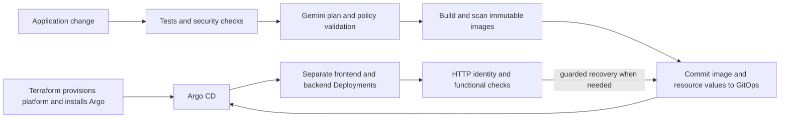

# Idea Board

A React frontend, FastAPI backend and PostgreSQL database for submitting and viewing ideas. Frontend and backend run as separate Kubernetes Deployments. GitHub Actions builds the application, Gemini proposes bounded resource settings, and Argo CD deploys the desired state from Git.

## Start here

| Task | Repository and guide |
| --- | --- |
| Run locally, develop a change or demonstrate AI | **This repository** |
| Provision infrastructure and install Argo CD | [terraform-infrastructure](https://github.com/surendarrajasekaran/terraform-infrastructure#readme) — private; access required |
| Prepare credentials, bootstrap the parent Application and inspect deployments | [infra-helm-charts](https://github.com/surendarrajasekaran/infra-helm-charts#readme) |

For a first cloud deployment, follow the Terraform guide, the GitOps setup guide, then configure Actions below. For an existing platform, use [Deploy a change](#deploy-a-change).

The AWS delivery path has been exercised end to end. GCP Terraform modules are available; live GCP application delivery remains outstanding. Environment identifiers and endpoints belong in target configuration and Actions settings.

## Run locally

Install Git, Docker and Docker Compose v2.

```sh
git clone https://github.com/surendarrajasekaran/om-idea-board.git
cd om-idea-board
cp .env.example .env
# Set POSTGRES_PASSWORD in .env to a local development password.
docker compose up --build --wait --wait-timeout 240
```

Open [http://localhost:8080](http://localhost:8080), submit an idea and refresh to check persistence. Compose starts PostgreSQL, runs the migration, then starts the backend and frontend.

```sh
docker compose down           # Stop; retain database data.
docker compose down --volumes # Stop and delete local database data.
```

## How delivery works



Terraform owns cloud resources and Helm release `argocd`. The GitOps parent Application owns two child Applications, which render nucleus with separate component values. CI publishes desired state to Git; Argo reconciles it. Normal releases need no developer cluster credentials.

## Configure GitHub Actions

The supplied release workflow targets `aws-test`. Create that GitHub environment in the app repository and configure these variables with your platform outputs:

| Variable | Value/source |
| --- | --- |
| `REGION` | Terraform output `region` |
| `AWS_ACCOUNT_ID` | Your expected target account ID |
| `AWS_ECR_PUSH_ROLE_ARN` | Terraform output `ecr_push_role_arn` |
| `ECR_REGISTRY` | Registry hostname from `repository_urls`; omit repository paths |
| `ECR_REPOSITORY_PREFIX` | Prefix matching the provisioned frontend/backend repositories |
| `GITOPS_REPOSITORY` | GitOps repository in `owner/repository` form |
| `DATABASE_EGRESS_CIDRS` | Output `database_egress_cidrs`, as a JSON array of strings |
| `PUBLIC_URL` | Frontend URL, once its LoadBalancer is available |

Add `GITOPS_SSH_KEY` as an Actions secret in `aws-test`. It is the private half of a write-enabled deploy key on the GitOps repository. AWS publishing uses short-lived OIDC credentials and ECR-only permissions. Terraform's trust settings must match the app repository and `aws-test` environment exactly.

Configure AI in **both app and GitOps repositories**:

| Setting | Purpose |
| --- | --- |
| Actions secret `GEMINI_API_KEY` | Gemini API credential |
| Actions variable `AI_PROVIDER=gemini` | Provider selection |
| Actions variable `AI_MODEL=gemini-3.5-flash-lite` | Model identifier |
| Optional repository variable `AI_ENVIRONMENT` | GitHub environment containing AI settings; otherwise test workflows use `aws-test` |

AI settings can be repository-level or belong to the selected environment. Create a selected environment in both repositories. Configure GitOps health write permissions using its README. Keep credentials in Actions secrets.

For a new target without an endpoint, follow the GitOps first-release sequence before setting `PUBLIC_URL`. Forks or different targets also require updating repository references, source pins, Argo definitions and workflow target constants; changing variables alone does not rename the shipped target.

## Deploy a change

1. Create a branch and change `frontend/` or `backend/`.
2. Open a pull request. **Verify** checks code, tests, dependency/configuration security, Helm rendering and Compose persistence.
3. Merge to `main`. **AWS ECR and Argo CD GitOps release** runs for application, helper and selected release-configuration changes.
4. The workflow validates an AI profile, builds/scans both images, then commits image digests, resources and release records to GitOps.
5. Argo reconciles both services. GitOps health verifies their versions and HTTP behavior, then records health or requests guarded recovery.

For a manual release, open **Actions → AWS ECR and Argo CD GitOps release → Run workflow**, select `main` and enter a resource goal. Enable `require_ai` to fail if no live, policy-valid proposal is accepted.

CI updates `helm-overides/idea-fe/custom-values.yaml` and `helm-overides/idea-be/custom-values.yaml` in GitOps. Continue application deployment through that Git flow; Argo reconciles manual image changes.

## Demonstrate AI

Open **Actions → Check live AI provider → Run workflow** on `main`. This workflow plans only and requires a live accepted response; it does not deploy.

> Cost-sensitive test environment for a small team. Keep one replica per service and at most 250m CPU. Request 256Mi memory per service. Explain the sizing trade-offs, availability limitations, assumptions and post-deployment checks.

In **Summary → AI resource plan**, show the goal, accepted settings and **AI detailed decision explanation**. Ten sections cover interpretation, replica/CPU/memory choices, alternatives, assumptions, risks, cost impact, verification and unsupported requests. Planning asks for approximately 500–750 words; actual length varies. Model, response ID, token usage and duration appear when returned. **Pipeline policy checks** are separate. Download `live-ai-check` for the structured response. The same report appears in the release workflow.

Current test policy permits **one replica per service**, CPU requests of **100m or 250m**, and memory requests of **128Mi, 256Mi or 512Mi**. One shared profile applies to both service containers. Fixed limits remain **1 CPU / 512Mi**; init-container resources and Terraform infrastructure are unchanged. Requests affect scheduling and resource shares; changing them alone does not reduce a fixed-size worker's bill.

Planning uses one call with a 3,000-output-token cap and 45-second timeout, without automatic retries. Model output is schema/policy-validated and never executed as commands. An unavailable or rejected proposal produces labeled `policy-fallback`, unless live AI was required. API charges and quotas depend on the configured provider project.

## Health and recovery

The GitOps monitor waits for matching frontend/backend identities, samples 20 readiness requests and performs create/read checks for a new release. Its telemetry is HTTP-only; it does not inspect pod CPU, memory or Kubernetes events. Healthy unchanged releases skip AI calls.

Deterministic gates can force recovery even if AI recommends `keep`. Recovery restores verified images/resources through Git, preserving current security and Secret references. It does not reverse database migrations, data or Terraform resources. A first installation has no verified previous release to restore. See the [GitOps guide](https://github.com/surendarrajasekaran/infra-helm-charts#health-and-recovery).

## Repository layout and local checks

| Path | Purpose |
| --- | --- |
| `frontend/`, `backend/` | App code, Dockerfiles and component tests |
| `scripts/ai_ops.py` | AI planning, assessment and safe Actions output |
| `scripts/release_config.py`, `scripts/workload_policy.py` | Image/resource validation and workload policies |
| `scripts/gitops_release.py`, `scripts/gitops_state.py` | Publish values and verified release/recovery records |
| `scripts/gitops_monitor.py`, `scripts/probe.py`, `scripts/smoke.py` | Runtime identity, readiness, functional and recovery checks |
| `scripts/security_scan.py`, `scripts/requirements.txt`, `tests/` | Security gates, helper dependencies and regression tests |
| `.github/` | Workflows, reviewed chart-source pin and SSH host keys |
| `docker-compose.yml`, `.env.example`, `Makefile` | Local development and checks |

Install Python 3.12, Node.js 22 and Helm 3.19. Clone `infra-helm-charts` beside this repository, or set `GITOPS_DIR` to its checkout. Docker is required for configuration security checks.

```sh
python3.12 -m venv .venv
.venv/bin/pip install -r backend/requirements-dev.txt
npm --prefix frontend ci
make test
make build
make helm-check
make security-check
```

Local backend tests can use SQLite; CI also tests PostgreSQL and database-role restrictions. CI fetches the chart revision in `.github/gitops-source.json`. When changing shared chart contracts or health/recovery helpers, review the corresponding source pins in both repositories.
