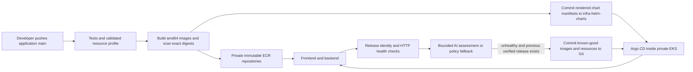

# AWS test GitOps delivery

The application source lives in `surendarrajasekaran/om-idea-board`. The desired deployment state lives in [infra-helm-charts](https://github.com/surendarrajasekaran/infra-helm-charts). Argo CD reads the latter repository from inside the private EKS cluster. GitHub-hosted build and health runners need no Kubernetes administrator credentials or private API connection.



## Release ownership

`.github/workflows/gitops-release.yml` runs on relevant application changes to main or through **Run workflow**. The developer can enter a goal such as `Cost-sensitive test environment for a small team` in that form; automatic source pushes use that default. The planner accepts only bounded values. Test profiles use one replica and at most 250m requested CPU per application; production retains its two-replica minimum in the shared planner.

After tests, the pipeline uses GitHub OIDC to assume the ECR publisher role. That role can publish only the frontend/backend repositories for this stack. Images have unique immutable tags, captured SHA-256 digests, SBOM/provenance and a fixable HIGH/CRITICAL image scan gate. A dedicated repository deploy key publishes rendered manifests and release metadata to the GitOps repository. No database passwords, CA Secrets or registry credentials enter Git.

The supplied nucleus 1.1.0 chart is copied unchanged into the GitOps repository with its provenance file. The publisher renders its two values files and shared namespace controls. Argo CD applies those manifests with controls first, then backend, then frontend. Annotation tracking keeps Argo ownership separate from Helm's existing selector labels. The AppProject allows only approved namespaced resources in `idea-board-test`; it cannot deploy Secrets or cluster resources. Namespace creation and database Secrets are bootstrap responsibilities.

The old direct Helm workflow skips AWS test deployment. Do not run `deploy.py` or the direct `run_platform.py` deployment against this Argo-managed application. Infrastructure remains owned by Terraform, and the Argo controller installation remains owned by its separate Helm release.

## AI provider and health assessment

Supported providers are `nvidia`, `groq`, and `openai`. Endpoints are fixed HTTPS allowlists; arbitrary proxy endpoints are not accepted. Provider responses are parsed and locally checked against a strict schema. Model text is never executed. Only resource goals or aggregate request counts/latency go to the model, never database credentials or idea content.

NVIDIA offers hosted open models for prototyping through its Developer Program; current access, quotas and terms are controlled by NVIDIA. A trial is not an unlimited production service. See [NVIDIA's API introduction](https://docs.api.nvidia.com/nim/docs/product). ChatGPT/Claude website access does not supply API credentials for a pipeline. Self-hosting an open model on an AWS GPU would add compute cost to this small test environment.

The `aws-test` GitHub environment in **both repositories** uses:

| Setting | Value |
| --- | --- |
| Variable `AI_PROVIDER` | `nvidia` |
| Variable `AI_MODEL` | `nvidia/llama-3.3-nemotron-super-49b-v1.5` |
| Secret `AI_API_KEY` | A provider key entered through GitHub's secret settings |

Without a key or on provider/schema failure, reports explicitly say `policy-fallback`. The release form's `require_ai` option rejects fallback for planning. No live model response should be claimed until a real call succeeds. Groq requires a model supporting the structured-output format used by the adapter.

The GitOps repository's health workflow runs on new release metadata, manual dispatch and a five-minute schedule (GitHub scheduling can be delayed). It waits for three consecutive responses matching **both** the frontend release header and backend release body, measures 20 readiness requests, and performs a create/read smoke test on a new release. This creates one identifiable test idea. Existing healthy releases avoid repeated model calls. This monitor has HTTP-only telemetry; it does not claim to observe pod restarts, logs, CPU or memory.

HTTP failure rate above 5%, p95 above 1500 ms, failed version convergence or a failed functional smoke forces recovery even if the model recommends keeping the release. A model may recommend an earlier rollback within that guardrail. Recovery needs a previously verified healthy snapshot: the first failed installation requires operator action. Snapshot checksums, expected-release checks and normal fast-forward Git pushes reject corruption or stale observations. A pending recovery blocks another automatic rollback until health is verified or an operator intervenes.

Recovery creates a new Git desired state using the previous healthy images, replicas and application resource requests/limits. It preserves current network/security controls, database/TLS/CA Secret references and other pod hardening. It does not reverse database migrations, restore data or destroy infrastructure. Schema migrations must therefore remain compatible with the previous application version. Argo CD reconciles the recovery commit; the next monitor must verify it before calling recovery successful.

## Provisioning and private administration

The selected target is AWS account `812752207041` (`mit-qa-administratoraccess`), `us-west-2`, name `idea-board`, environment `test`. The default network `10.40.0.0/16` is separate from existing account workloads. Test capacity is one on-demand `t3.medium`, one managed NAT gateway and private `db.t3.micro` PostgreSQL. This is a cost-conscious demonstration with single-node availability limits; EKS, NAT, RDS, worker, public load balancer, logs and storage remain chargeable while it exists.

`infra/bootstrap` provisions a versioned, public-blocked, TLS-required S3 state bucket, a rotating customer-managed KMS key and the account GitHub OIDC provider. Both bootstrap and application state use S3 native locking and explicitly name the KMS key in their backend configuration. State/plan files contain credentials and are ignored. Reuse an account's existing GitHub OIDC provider instead of creating duplicates.

After reviewing an exact-account Terraform plan, apply it with the ignored target variable file. Terraform outputs include ECR URLs, cluster name and sensitive DB connection material. Never print the full output object or upload state/plan files.

The EKS API is private. Optional worker SSM access is enabled for this test, with no SSH listener. An authorized SSO administrator can start a temporary tunnel without changing their normal kubeconfig:

```sh
AWS_PROFILE=mit-qa-administratoraccess python scripts/private_eks.py \
  --profile mit-qa-administratoraccess --region us-west-2 \
  --cluster idea-board-test --kubeconfig artifacts/aws-test/kubeconfig.yaml
# Keep that process running; in another terminal:
export AWS_PROFILE=mit-qa-administratoraccess
export AWS_REGION=us-west-2
export KUBECONFIG="$PWD/artifacts/aws-test/kubeconfig.yaml"
kubectl --context idea-board-test get nodes
```

AWS CLI and the Session Manager plugin are prerequisites. The tunnel preserves the real endpoint's TLS hostname/CA validation and IAM authentication. SSM is an administrative capability and should be granted narrowly to operators.

Download the official Argo chart referenced by `deploy/argocd/chart-lock.json`, verify its SHA-256, then run the bootstrap with Terraform 1.11.4 on PATH:

```sh
python scripts/bootstrap_gitops.py --context idea-board-test \
  --account-id 812752207041 --region us-west-2 \
  --chart /path/to/verified/argo-cd.tgz \
  --application ../infra-helm-charts/bootstrap/idea-board-test.yaml
```

The bootstrap verifies the AWS account, Terraform target and Kubernetes CA, applies namespace policies and Secrets through stdin, then installs Argo and its scoped Application. Argo's UI is ClusterIP-only. Access it through the private tunnel using `kubectl -n argocd port-forward svc/argocd-server 8443:443`; retrieve its initial administrator password through an authorized secret-read operation without putting it in chat, logs or Git. Replace the initial credential after login.

After the frontend load balancer is reachable, configure `PUBLIC_URL` in the source repository's `aws-test` environment and the current GitOps `release.json`. That enables independent health checks. Test ingress is HTTP and the board is anonymous; use synthetic data. Production needs a trusted certificate/domain and application access controls appropriate to its use.

## Review evidence

Use `docs/verification.md` for observed results. A rendered chart, accepted Terraform plan or scheduled workflow definition alone is not evidence of a successful deployment, live AI response or successful rollback. The AWS deployment does not complete the assignment's separate GCP/public-URL requirement.
