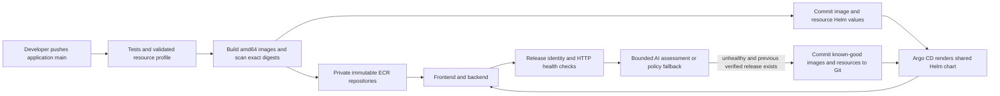

# AWS test GitOps delivery

The application source lives in `surendarrajasekaran/om-idea-board`. The desired deployment state lives in [infra-helm-charts](https://github.com/surendarrajasekaran/infra-helm-charts). Argo CD reads the latter repository from inside the private EKS cluster. GitHub-hosted build and health runners need no Kubernetes administrator credentials or private API connection.



## Release ownership

`.github/workflows/gitops-release.yml` runs on relevant application changes to main or through **Run workflow**. The developer can enter a goal such as `Cost-sensitive test environment for a small team` in that form; automatic source pushes use that default. The planner accepts only bounded values. Test profiles use one replica and at most 250m requested CPU per application; production retains its two-replica minimum in the shared planner.

After tests, the pipeline uses GitHub OIDC to assume the ECR publisher role. That role can publish only the frontend/backend repositories for this stack. Images have unique immutable tags, captured SHA-256 digests, SBOM/provenance and a fixable HIGH/CRITICAL image scan gate. A dedicated repository deploy key publishes Helm values, rendered snapshots and release metadata to the GitOps repository. No database passwords, CA Secrets or registry credentials enter Git.

The chart and values live in `infra-helm-charts`: `helm-templates/nucleus`, `helm-templates/nucleus-source.json`, `helm-overides/idea-fe/custom-values.yaml` and `helm-overides/idea-be/custom-values.yaml`. The chart remains the unchanged user-supplied nucleus 1.1.0. CI overlays immutable image tags/digests, validated resources and release identity onto the current component values, preserves their security/Secret settings, previews the exact Helm render and commits both values files plus checksummed snapshots.

Argo CD maintains exactly two Applications: `idea-board-backend` and `idea-board-frontend`. Both render the common chart with their own values and stable Helm release name. Backend also includes namespace security controls from `environments/<target>/manifests/controls.yaml`; controls precede backend resources through sync waves. Helm test hooks are skipped. The two Applications reconcile independently, so Application annotations do not guarantee backend-before-frontend ordering. The paired HTTP release monitor waits for both components before assessing a release. The other rendered files under `manifests` are recovery/evidence inputs and are excluded from Argo’s directory source. Annotation tracking preserves existing Helm selector labels. The AppProject permits only approved namespaced resources, excluding Secrets and cluster resources; namespace and credential/CA Secrets remain bootstrap responsibilities.

Application CI fetches the pinned GitOps revision in `deploy/gitops/chart-source.json` for chart-contract checks, without duplicating the chart in the source repository. Local checks use a sibling GitOps checkout or `GITOPS_DIR`. GitOps chart/value changes have their own validation workflow.

The old GHCR/direct-Helm Actions workflow has been removed. Do not run `deploy.py` or the direct `run_platform.py` deployment against this Argo-managed application. Infrastructure remains owned by Terraform, and the Argo controller installation remains owned by its separate Helm release.

## AI provider and health assessment

Supported providers are `gemini`, `nvidia`, `groq`, and `openai`. The selected provider for this test is Gemini. Endpoints are fixed HTTPS allowlists; arbitrary proxy endpoints are not accepted. Provider responses are parsed and locally checked against a strict schema. Model text is never executed. Only resource goals or aggregate request counts/latency go to the model, never database credentials or idea content.

Gemini uses Google's native `generateContent` REST API with `x-goog-api-key` authentication in a header and JSON-schema output. The model identifier is validated before constructing the fixed Google URL; authentication headers are never forwarded on redirects. Blocked, truncated, oversized, malformed or out-of-policy output is rejected locally. A request has a 30-second timeout, one candidate and a 1,200-token output limit; quota errors are not retried or switched to another provider.

AI jobs can use a dedicated secret environment. Set the repository variable `AI_ENVIRONMENT` to its name; otherwise they use the target environment (`aws-test`). The current test uses **environment `GEMINI_API_KEY` in both repositories**, where the replacement secret was saved. AWS image/publish jobs use `aws-test` independently. Configure these values in the selected AI environment:

| Setting | Value |
| --- | --- |
| Repository variable `AI_ENVIRONMENT` | `GEMINI_API_KEY` for this test; optional, defaults to target environment |
| Variable `AI_PROVIDER` | `gemini` |
| Variable `AI_MODEL` | `gemini-3.5-flash-lite` |
| Secret `GEMINI_API_KEY` | A Gemini API key entered through GitHub's secret settings |

Create the key in [Google AI Studio](https://aistudio.google.com/api-keys), then add it as a secret in the selected AI environment in [om-idea-board](https://github.com/surendarrajasekaran/om-idea-board/settings/environments) and [infra-helm-charts](https://github.com/surendarrajasekaran/infra-helm-charts/settings/environments). A repository secret with the same name also works. Environment names and secret names are separate settings; a workflow can only read environment secrets from the environment declared on its job. Manual CLI operations use securely exported credentials; the GitOps job selector applies only to these workflows. A provider-specific key takes precedence over the legacy generic `AI_API_KEY`; remove obsolete generic keys when switching providers. Never paste keys into chat, commands, manifests or Terraform. Revoke exposed keys and update both secrets with the replacement.

Select a **Free Tier** project in AI Studio to stay within its free quota. A billing-enabled project's requests can incur charges; selecting Gemini or creating a key does not guarantee free usage. This test pins `gemini-3.5-flash-lite` after the original `gemini-flash-latest` checks returned HTTP 503 and timed out. The user approved Flash-Lite, and its required-live check succeeded. The `gemini-flash-latest` alias remains accepted but can change its underlying model and availability. Check the project's actual quota and [Google's current pricing](https://ai.google.dev/gemini-api/docs/pricing) before enabling billing or changing models. Free-tier content may be used to improve Google's products: send only generic resource goals and numeric health aggregates, never sensitive operational data. See the [model alias documentation](https://ai.google.dev/gemini-api/docs/models#latest).

Use the manual **Check live AI provider** workflow to validate a replacement key/model with one required-live proposal and no image build or infrastructure change. Its goal input supports planning demos. Both this workflow and the release planner print the goal, configured provider/model and validated plan in the step logs and append an **AI resource plan** table to the run summary. The health workflow similarly prints its decision and numeric evidence and appends an **AI health assessment** table. Only approved report fields are displayed; credentials are redacted, untrusted text is escaped, and fallback/skipped calls are explicitly labeled. Errors expose only safe HTTP status or validation reasons, never provider bodies or keys.

Without a key or on provider/schema failure, reports explicitly say `policy-fallback`. The release form's `require_ai` option rejects fallback for planning. No live model response should be claimed until a real call succeeds. OpenAI, NVIDIA and Groq adapters remain available with their own configured model/key; Groq requires a model supporting the adapter's structured-output format.

The GitOps repository's health workflow runs on new release metadata, manual dispatch and a five-minute schedule (GitHub scheduling can be delayed). It waits for three consecutive responses matching **both** the frontend release header and backend release body, measures 20 readiness requests, and performs a create/read smoke test on a new release. This creates one identifiable test idea. Existing healthy releases avoid repeated model calls. This monitor has HTTP-only telemetry; it does not claim to observe pod restarts, logs, CPU or memory.

HTTP failure rate above 5%, p95 above 1500 ms, failed version convergence or a failed functional smoke forces recovery even if the model recommends keeping the release. A model may recommend an earlier rollback within that guardrail. Recovery needs a previously verified healthy snapshot: the first failed installation requires operator action. Snapshot checksums, expected-release checks and normal fast-forward Git pushes reject corruption or stale observations. A pending recovery blocks another automatic rollback until health is verified or an operator intervenes.

Recovery updates the same Helm values with previous verified images, replicas and application resource requests/limits, re-renders the current chart, and saves a new checksummed recovery snapshot. Older manifest-only snapshots remain valid recovery candidates. It preserves current network/security controls, database/TLS/CA Secret references and other pod hardening. It does not reverse database migrations, restore data or destroy infrastructure. Schema migrations must therefore remain compatible with the previous application version. Argo CD reconciles the recovery commit; the next monitor must verify it before calling recovery successful.

## Demo

1. In application Actions, run **Check live AI provider** on `main` and enter a resource goal. Its **AI resource plan** job-summary table and step logs show configured provider/model, goal, accepted replicas/CPU/memory, rationale and result source. `live-ai` is a validated live response; fallback and skipped calls are labeled explicitly. This workflow makes one planning call and does not deploy.
2. For end-to-end delivery, run **AWS ECR and Argo CD GitOps release**, enter the goal and enable `require_ai`. Show the plan summary, image build/scan results, then the GitOps commit updating `helm-overides/idea-fe/custom-values.yaml` and `helm-overides/idea-be/custom-values.yaml`.
3. Show the two Argo Applications, `idea-board-backend` and `idea-board-frontend`, rendering `helm-templates/nucleus` with those values. Each owns its existing Deployment/Service. Backend also owns the shared namespace controls; both Applications sync independently.
4. Open the newly triggered GitOps health run. Its **AI health assessment** summary shows aggregate evidence, final keep/rollback decision and rationale. Already healthy unchanged releases skip the model, so use a new-release run when demonstrating live AI assessment. Health checks and successful create/read verify the deployed release.

A successful visible planning example is [run 41289856695](https://github.com/surendarrajasekaran/om-idea-board/actions/runs/41289856695). The direct-Helm release is [run 41291253782](https://github.com/surendarrajasekaran/om-idea-board/actions/runs/41291253782), with [live AI health evidence](https://github.com/surendarrajasekaran/infra-helm-charts/actions/runs/41291414658). Sign into GitHub to inspect the full run presentation and download artifacts.

## Provisioning and private administration

The selected target is AWS account `812752207041` (`mit-qa-administratoraccess`), `us-west-2`, name `idea-board`, environment `test`. The default network `10.40.0.0/16` is separate from existing account workloads. Test capacity is one on-demand `t3.medium`, one managed NAT gateway and private `db.t3.micro` PostgreSQL. This is a cost-conscious demonstration with single-node availability limits; EKS, NAT, RDS, worker, public load balancer, logs and storage remain chargeable while it exists.

`infra/bootstrap` provisions a versioned, public-blocked, TLS-required S3 state bucket, a rotating customer-managed KMS key and the account GitHub OIDC provider. Both bootstrap and application state use S3 native locking and explicitly name the KMS key in their backend configuration. State/plan files contain credentials and are ignored. Reuse an account's existing GitHub OIDC provider instead of creating duplicates.

After reviewing an exact-account Terraform plan, apply it with the ignored target variable file. Terraform outputs include ECR URLs, cluster name and sensitive DB connection material. Never print the full output object or upload state/plan files.

The EKS API is private. Optional worker SSM access is enabled for this test, with no SSH listener. An authorized SSO administrator can start a temporary tunnel without changing their normal kubeconfig:

```sh
AWS_PROFILE=mit-qa-administratoraccess python scripts/private_eks.py \
  --profile mit-qa-administratoraccess --region us-west-2 \
  --cluster idea-board-test --kubeconfig artifacts/aws-test/kubeconfig.yaml
# Keep that process running; in another terminal:
export AWS_PROFILE=mit-qa-administratoraccess
export AWS_REGION=us-west-2
export KUBECONFIG="$PWD/artifacts/aws-test/kubeconfig.yaml"
kubectl --context idea-board-test get nodes
```

AWS CLI and the Session Manager plugin are prerequisites. The tunnel preserves the real endpoint's TLS hostname/CA validation and IAM authentication. SSM is an administrative capability and should be granted narrowly to operators.

Download the official Argo chart referenced by `deploy/argocd/chart-lock.json`, verify its SHA-256, then run the bootstrap with Terraform 1.11.4 on PATH:

```sh
python scripts/bootstrap_gitops.py --context idea-board-test \
  --account-id 812752207041 --region us-west-2 \
  --chart /path/to/verified/argo-cd.tgz \
  --project ../infra-helm-charts/bootstrap/idea-board-project.yaml \
  --application-chart ../infra-helm-charts/helm-templates/argocd-app-controller \
  --application-values ../infra-helm-charts/helm-overides/argocd-app-controller/custom-values.yaml
```

The bootstrap verifies the AWS account, Terraform target and Kubernetes CA, applies namespace policies and Secrets through stdin, then installs Argo, its scoped AppProject and Helm bootstrap release `idea-board-test-apps`. That release renders exactly two Application resources from a reusable chart; it creates no additional controller Pods or parent Application. The controller release remains `argocd`. Argo's UI is ClusterIP-only. Access it through the private tunnel using `kubectl -n argocd port-forward svc/argocd-server 8443:443`; retrieve its initial administrator password through an authorized secret-read operation without putting it in chat, logs or Git. Replace the initial credential after login.

To update Application definitions after bootstrap, review/render the generic chart and upgrade its separate release through the private connection:

```sh
helm upgrade --install idea-board-test-apps \
  ../infra-helm-charts/helm-templates/argocd-app-controller \
  --namespace argocd --kube-context idea-board-test --atomic --wait \
  -f ../infra-helm-charts/helm-overides/argocd-app-controller/custom-values.yaml
```

The chart defaults to no cascading-deletion finalizer and adds no replica-ignore rules. Removing an Application definition leaves its workloads in place; retiring workloads requires a separate explicit operation. For migration from the former `idea-board-test` Application, pause its sync, back up its definition, remove only that Application without cascading deletion, and transfer tracking annotations on the exact existing resources to their new owner before enabling the new Applications. Preserve resource UIDs, selectors and the LoadBalancer address. See Argo's [tracking](https://argo-cd.readthedocs.io/en/stable/user-guide/resource_tracking/) and [deletion](https://argo-cd.readthedocs.io/en/stable/user-guide/app_deletion/) documentation. Never run both old and new owners concurrently.

After the frontend load balancer is reachable, configure `PUBLIC_URL` in the source repository's `aws-test` environment and the current GitOps `release.json`. That enables independent health checks. Test ingress is HTTP and the board is anonymous; use synthetic data. Production needs a trusted certificate/domain and application access controls appropriate to its use.

## Review evidence

Use `docs/verification.md` for observed results. A rendered chart, accepted Terraform plan or scheduled workflow definition alone is not evidence of a successful deployment, live AI response or successful rollback. The AWS deployment does not complete the assignment's separate GCP/public-URL requirement.

## Controller image maintenance

The upstream Argo CD 3.5.6 image scan found fixable HIGH/CRITICAL issues in bundled utilities and dependencies. This test installs Docker's maintained hardened 3.5.6 image instead, pinned in `deploy/argocd/image-lock.json` and mirrored without changing the Linux amd64 manifest digest into `idea-board-test/argocd`. The platform operator owns that mirror; the application publisher role remains limited to frontend/backend. No Docker registry credential is copied into Kubernetes. The selected Redis 8.10.3 image is independently digest-pinned and scanned.

`aws_additional_ecr_services=["argocd"]` provisions the mirror repository. To refresh it, inspect the official Docker hardened-image catalog/version, authenticate with an existing authorized Docker registry identity, scan the exact upstream digest, copy that platform manifest into the private repository and verify that ECR reports the identical digest. Review the chart's binary paths/user compatibility, update the image lock and values together, and perform a private Helm controller upgrade followed by GitOps/application health checks. Do not grant application CI the platform mirror's publishing permissions.

The hardened-image scan covers its recognized distribution packages; Trivy reported no embedded Go module metadata for that image. Its clean package result is not proof of zero application vulnerabilities. Keep the pinned Docker build/package provenance and refresh from maintained sources. Argo CD itself remains a privileged cluster controller and a trust root: its AppProject limits Git-managed resources, while its controller's Kubernetes permissions follow the upstream chart. Restrict operator access and review a namespace-scoped controller installation before sharing this cluster with unrelated tenants.

When rotating database/CA or TLS Secrets, bootstrap the new values through the authenticated private connection and publish a new GitOps release to restart pods and reload them. Git does not hold Secret bytes, so editing a Secret alone does not automatically change an application's pod template. Validate connections/certificates after rotation.

The controller has a 300-second sync-operation deadline and both Applications use `retry.refresh=true`. A failed rollout therefore cannot hold an old revision indefinitely while a recovery commit waits in Git. The normal HTTP convergence allowance is 600 seconds; the CLI accepts an explicitly bounded 30-1800 second override for controlled exercises. Detection/reconciliation are periodic and are not an instantaneous rollback guarantee.

An expired SSM session only affects private administration, but it can interrupt an in-progress controller Helm operation. Check Helm history and restore the last deployed **controller** revision before retrying its update if it is left `pending-upgrade`. This is distinct from application recovery, which always changes Git. The selected Helm chart has no `applicationSet.enabled` switch, so the unused test ApplicationSet controller is configured with `replicas: 0` rather than relying on an ignored value.

## GitHub OIDC subject format

GitHub can include immutable owner/repository IDs in its OIDC subject. Query `gh api repos/OWNER/REPO/actions/oidc/customization/sub` and use its `sub_claim_prefix` as Terraform `github_oidc_subject_prefix`. For this source repository the prefix is `repo:surendarrajasekaran@35868093/om-idea-board@1438722777`. The trust policy appends `:environment:aws-test` and still requires audience `sts.amazonaws.com` with exact StringEquals matching. It does not accept wildcard repositories, another repository's prefix, or arbitrary branches outside the GitHub environment's main-only policy.

Older repositories can leave the prefix unset to retain their legacy name-based subject. Do not disable immutable IDs to repair a trust mismatch. Match the actual repository settings; see [GitHub's OIDC reference](https://docs.github.com/en/actions/reference/security/oidc). The CI registry module tests both formats and rejects an unrelated repository prefix.
